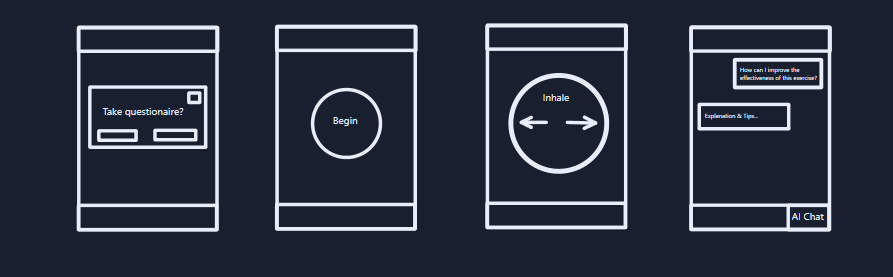

# Assignment 3 Part 1 Report

This report regards the creation of a mental health app with a structured-breathing skill to aid users in grounding during distress.

## Git
Link: https://github.com/dw477/mental-health-app

## App Flow

### Description

The app will start off recommending a questionaire to those who want an automatic judgement of the length of the breathing exercise. For those who do not, the questionaire is able to be skipped, emphasizing that skipping does not automatically lower the exercise's effectiveness, and the duration defaults to 45s (R2, R4, D3). The skill is the main screen; it does not need to be navigated to, and it does not need a previous understanding of the app to use (R2, D3, D2). The user is able to press a button to start the exercise, beginning a small countdown. This can be pressed again to stop the exercise (R3, R4). Throughout the exercise, the user is guided with animations depicting inhale-exhale timing involving a soft color palette and smooth transitions (D6). When finished, the user is free to exit, use the language model, or navigate the app to change settings/preferences.

### Diagram

Diagram is included in the repository's reports folder.

## Use of Model; Type of Data

### Model

In this project, the role of the model is to supplement the user with information when needed. With that the user needs the least amount of friciton and as much of a reduced cost of use as possible, the model will not be a front-page feature (R2, D3). Instead, it will be in the app's available tools for the user to use when they choose to.

### Data

I expect to store data based on who the user is. I also expect to store data based on questions the user answers within the app so that they can access requested functions/materials without re-inputting data (R2). For example, when the app is first started, they may enter their name, age, and input answers to a few questions. It would be beneficial to store this for a recurring use of the app. 

Using the State Trait Anxiety Inventory paper regarding a present-focused questionaire, each question would tally up to a final score, controlling the app's specific recommendation for the user's use of the paced breathing skill. This recommendation involves personalization through the proposed length of the breathing skill, with shorter lengths being for those who are in higher distress. The user will be able to manually control the length of the breahting skill, from 30s-90s (R1). They will be able to manually re-take the questionaire to have their distress level reassessed as well.